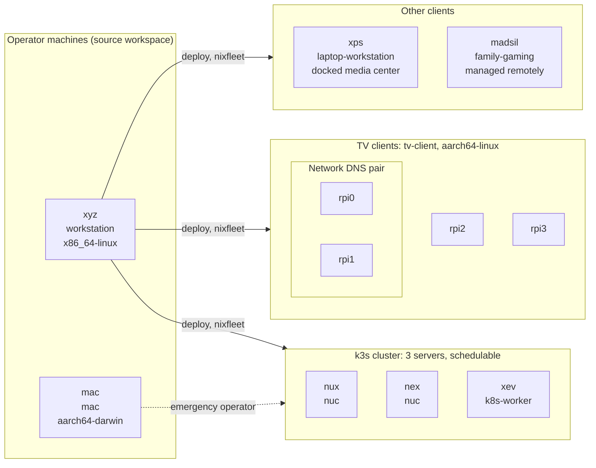
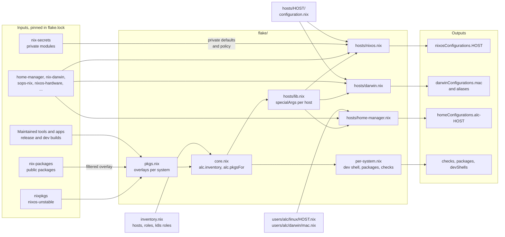
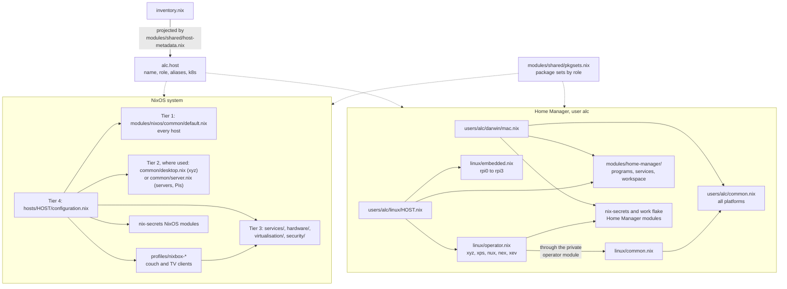
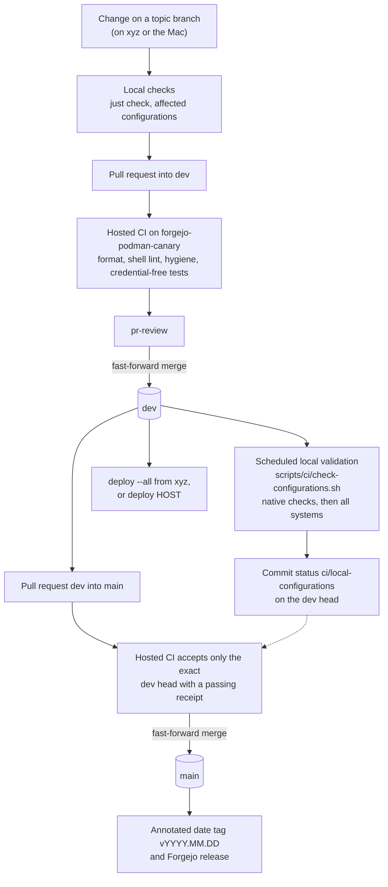
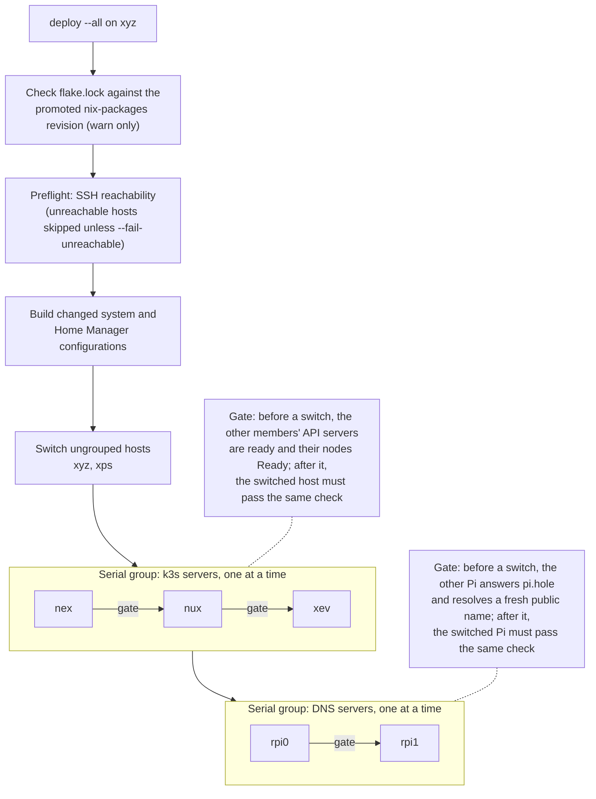
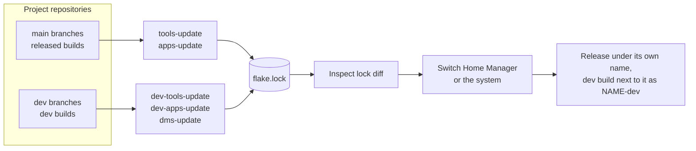

# Architecture diagrams

Overview diagrams of this flake, in Mermaid so Forgejo and GitHub render them
inline. They summarise the code and the linked decisions. If a diagram and the
code disagree, the code wins, so update the diagram along with any change it
depicts. Private material (endpoints, secret wiring, builder selection,
runbooks) stays in `nix-secrets` and is shown here only as an opaque box.

1. [Fleet](#fleet)
2. [Flake composition](#flake-composition)
3. [Configuration layering](#configuration-layering)
4. [From change to deployment](#from-change-to-deployment)
5. [Fleet deploy order](#fleet-deploy-order)
6. [Maintained project refresh](#maintained-project-refresh)

## Fleet

Hosts and their inventory roles, from [`inventory.nix`](../inventory.nix).
The three cluster members are all embedded-etcd k3s servers that also run
workloads ([ADR-0017](adr/0017-k3s-cluster-topology.md)). The two DNS Pis
resolve names for the whole network outside the cluster, so they are never
down together.

Servers and Pis hold no repository clones: every change is made on `xyz` or
the Mac and switched remotely. `xps` and the TV clients are controller-first
Moonlight clients ([nixbox client guide](nixbox-client.md),
[gaming map](gaming/README.md)).

## Flake composition

How [`flake.nix`](../flake.nix) turns inputs and the inventory into outputs
through the [flake-parts](https://flake.parts) modules in [`flake/`](../flake).
Every host output is built from the same per-system package set and the same
inventory-derived `specialArgs`.

The NixOS builder also asserts that k3s is enabled exactly on the hosts the
inventory gives a `k8sRole`. See
[ADR-0007](adr/0007-filtered-nix-packages-overlay.md) for the filtered package
overlay and [ADR-0002](adr/0002-nix-secrets-separate-repository.md) for the
private repository boundary.

## Configuration layering

Each host composes its NixOS system from four tiers
([ADR-0006](adr/0006-four-tier-module-layering.md)), and its Home Manager
profile from a matching user chain. Both read host facts from one typed
projection of the inventory, `alc.host`, instead of branching on host names.

`xps` and `madsil` import no Tier 2 layer: the XPS composes the Nixbox
session profile and madsil its gaming services directly. `madsil` also embeds
Home Manager for the family user from [`users/madsil/`](../users/madsil) in its
NixOS configuration, alongside the standalone `alc-madsil` profile from
`users/alc/linux/madsil.nix`. The inventory role picks
each host's package sets, so host files write
`pkgsets.home.${hostRole.homePackageSet}` rather than naming a role
([ADR-0008](adr/0008-pkgsets-centralised-package-management.md)).

## From change to deployment

The path a change takes from a branch to the hosts. Pull requests into `dev`
run only credential-free checks; the full evaluation of every exported system
runs in a scheduled, trusted local job, and its commit status is the receipt
the promotion to `main` requires ([validation](validation.md),
[ADR-0067](adr/0067-explicit-consumer-and-platform-validation.md),
[ADR-0098](adr/0098-date-tagged-promotions.md)).

Hosts are deployed from the operator's checkout, normally `dev`; the
promotion records a validated, tagged state of it. `deploy` warns when the
lock does not point at the validated `nix-packages` revision
([ADR-0080](adr/0080-promoted-package-ref.md)).

## Fleet deploy order

What `deploy --all` does, as configured by
[`packages/nix-deploy`](../packages/nix-deploy/default.nix) from the
inventory. Only changed configurations are switched, and hosts with
`deployAll = false` (`madsil`, `rpi2`, `rpi3`) are left out unless named.
Home Manager profiles switch too; the serial groups govern system switches.

Every member must pass its check before the group starts. A failed check
stops the group and leaves its remaining members untouched, so `deploy` switches
at most one etcd member or resolver at a time and only while the others answer
their checks. It cannot protect against a member failing for other reasons
during the switch. Node
reboots are separate (`kreboot`, `koff`, `kon`); `nixfleet status` only reads
state.

## Maintained project refresh

How the owner's tools and apps reach the hosts
([README](../README.md#maintained-projects),
[ADR-0086](adr/0086-released-tool-inputs.md),
[ADR-0087](adr/0087-side-by-side-dev-tools.md),
[ADR-0089](adr/0089-released-and-dev-app-inputs.md)). The commands only move
pins in `flake.lock`; a rebuild never moves an input to a newer branch head.

Projects without releases yet, and apps that cannot run twice on one host,
follow `dev` under their own name instead of getting a `-dev` twin.
